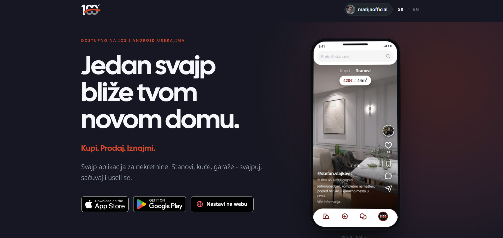
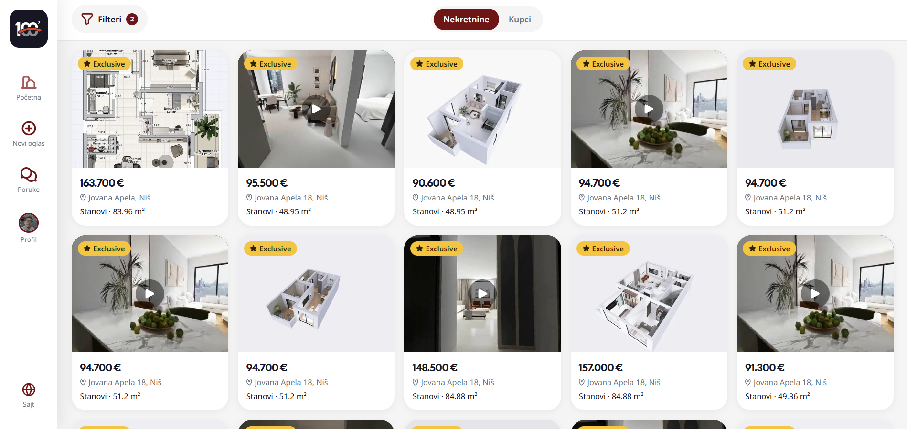
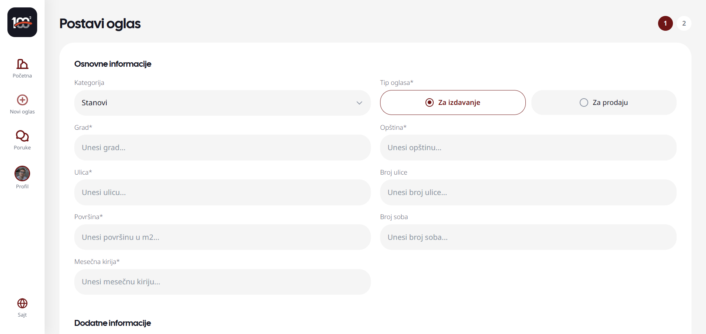

# Hi, I'm Matija 👋

Full-stack developer from Belgrade. I build web and mobile products with **React, Next.js, TypeScript, .NET / C# and Supabase**.

---

## 🏠 Featured project: [100 Kvadrata (100m²)](https://github.com/Matijahh/100kvadrata-web)

A real estate platform where you browse properties in a vertical, video-first feed (like Reels) instead of endless lists.

100 Kvadrata started as a **mobile app** (React Native / Expo, for iOS and Android). This repo is its **web version**: the public website plus the full app in the browser. Both run on the same Supabase backend, so accounts, listings and chats carry over between phone and web. The two codebases also share their business logic (types, data services, state and translations) through a sync script, so a feature built once works on both platforms. The mobile app's source is private and available on request.

  
  
  

- **Feed**: reel layout on phones, grid on desktop, with filters, saved searches and a buyers feed
- **Listings**: create and edit with drag-and-drop media, HEIC conversion and in-browser video processing
- **Messaging**: chat inbox and notifications for likes, saves and offers
- **Auth**: email OTP, Google and Apple sign-in, with access control enforced by Postgres Row Level Security
- **SEO**: server-rendered listing pages with OG images and JSON-LD, plus app links into the mobile app
- **Quality**: Serbian / English i18n, strict CSP and security headers, Playwright tests on desktop and phone viewports

**Stack:** Next.js 16 · React 19 · TypeScript · Tailwind CSS v4 · Radix · React Query · Zustand · Supabase · Playwright · Vercel

🔗 **[Live website](https://www.100-kvadrata.rs/)** · **[Source code](https://github.com/Matijahh/100kvadrata-web)**

---

## 📂 Other projects

| Project | What it is | Stack |
|---|---|---|
| [hulahop](https://github.com/Matijahh/hulahop) | Print-on-demand marketplace: admins define base garments, associates place their designs on them and sell through their own brand store | React, Vite, MUI, Redux, Konva · NestJS, TypeORM, MySQL, JWT |
| [powerp](https://github.com/Matijahh/powerp) | Website for a real client presenting their business, team, projects and partners | HTML, CSS, JavaScript |

---

## 🛠️ Tech I work with

**Languages:** TypeScript, JavaScript, C#, SQL, HTML, CSS
**Frontend:** React, Next.js, React Native (Expo), Tailwind CSS, Redux Toolkit, Zustand, React Query
**Backend:** .NET, Supabase (Postgres, RLS, Edge Functions), Node.js, Express, NestJS, TypeORM, MySQL, MongoDB, Firebase
**Tools:** Git, Vercel, Playwright, Figma

---

## 📫 Contact

<!-- Fill in the ones you want public -->
- LinkedIn: [matijaradicevic](https://www.linkedin.com/in/matijaradicevic/)
- Email: matijaradicevic2552@gmail.com
